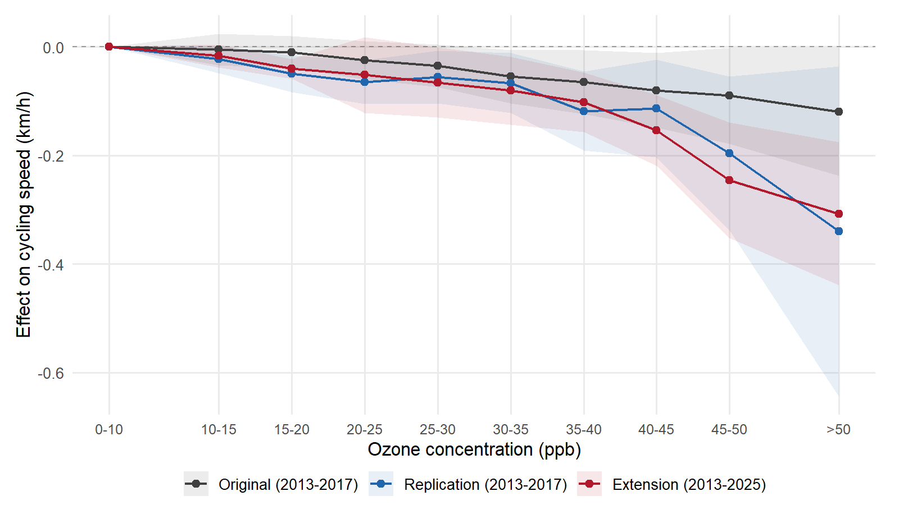
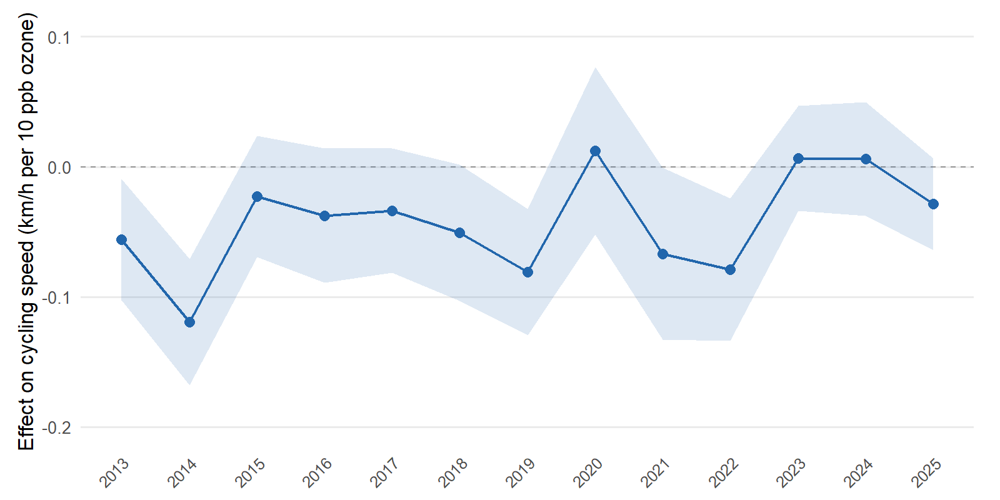

# Urban Air Pollution and Time Losses: Evidence from Cyclists in London — Revisited

[Klingen and van Ommeren (2020)](https://doi.org/10.1016/j.regsciurbeco.2019.103504) showed that ozone pollution reduces cycling speed in London, using 42 million Santander Cycles trips during 2013--2017. A 10 ppb increase in ozone --- roughly the difference between a clean and a moderately polluted day --- reduced average speed by 0.3--0.4%, with effects detectable at concentrations as low as 20 ppb. The paper used four complementary identification strategies to rule out confounding from weather, traffic, and cyclist sorting.

This repository extends the analysis to 112 million trips through 2025. The code replicates the original estimation and tests whether the ozone--speed relationship persists across a period that includes COVID-19, the Ultra Low Emission Zone expansion, and substantial changes to London's cycling infrastructure. It does.

## Results

The table below compares the original estimates to our replication and the extended sample across three identification strategies.

**Effect of ozone on cycling speed (km/h per 10 ppb)**

| Identification strategy | Original (2013--2017) | Replication (2013--2017) | Extension (2013--2025) |
|---|:---:|:---:|:---:|
| Within-day | -0.053\*\*\* | -0.047\*\*\* | -0.057\*\*\* |
| Spatio-temporal (zone-week) | -0.044 | -0.049 | -0.075\*\*\* |
| Cyclist panel (all distances) | -0.026\*\*\* | -0.014\*\*\* | -0.009\*\*\* |

\*\*\* p<0.01, \*\* p<0.05

Using 5 ppb ozone bin indicators, both the replication and extension samples show a roughly linear decline in speed with increasing ozone, with effects becoming visible around 15--20 ppb --- consistent with the original finding that the threshold is well below regulatory standards.

<p align="center">
  
</p>

Estimating the model separately for each year gives negative estimates in most years, but estimates close to zero in 2020, 2023 and 2024.

The cyclist panel confines a pseudo-cyclist to one route, clock hour and year-month (the original study pooled the calendar month over all years) and excludes e-bikes (from 2022-09). This halves the panel estimate relative to the original study.

<p align="center">
  
</p>

## Data

The analysis uses three data sources:

- **Cycling trips**: Transport for London (TfL) Santander Cycles, available from the [TfL cycling data portal](https://cycling.data.tfl.gov.uk/)
- **Air quality**: London Air Quality Network, hourly data from 5 monitoring stations (BL0, KC1, RI2, SK6, TH4), via the [Imperial College API](https://www.londonair.org.uk/LondonAir/API/)
- **Weather**: [Open-Meteo Archive API](https://open-meteo.com/en/docs/historical-weather-api), central London (51.52N, 0.11W)

Raw data files are too large for this repository. The journeys, the air quality and the weather are read from the shared London data store (`../london_transport_data`), through the readers in [`../london_transport_repo`](../london_transport_repo) (`R/london_transport.R`; the catalog `london_data_catalog.md` documents every dataset). The store's download scripts retrieve them from the sources above: `scripts/20_download_santander.R` (journeys), `scripts/30_download_laqn.R` (air quality) and `scripts/31_download_openmeteo.R` (weather). The station table that locates the journeys (BikePoint ids of 2026-03 plus the station numbers used from 2022-09, matched by name) is in the store too, `ozone_stations_read()`; the scripts that built it (`R/01*`, which also kept a local copy of every journey file) are in this repository's git history. The project keeps no raw data of its own.

Times: the air quality and weather are in GMT. TfL publishes the journeys' clock times in GMT up to the extract ending 2013-09-13 and in UK local time from 2013-09-14 on; `scripts/data_management/04_clean_cycling.R` converts them to GMT with the store's true times (`CLOCK <- "true"`). The 2026-03 run read every clock time as GMT, which put summer journeys one hour late against the environmental data; `CLOCK <- "published"` reproduces that.

`output/`, the paper and the results above were rerun from `scripts/data_management/04_clean_cycling.R` on 2026-11-11 with the true clock times and the year-month panel. The within-day estimate no longer rises after 2017 (the earlier runs read every clock time as GMT and gave -0.095 for 2013-2025).

## Replication

### Requirements

R 4.3+ with the following packages: `data.table`, `arrow`, `fixest`, `ggplot2`, `lubridate`, `suncalc`, `sf`, `jsonlite`, `curl`, `gridExtra`. These are installed automatically by `scripts/project_init.R`.

### Running the analysis

Scripts are numbered in order of execution. From the project root:

```bash
# The journeys, stations, air quality and weather are read from the London store

# Clean and merge (~30 minutes)
Rscript scripts/data_management/04_clean_cycling.R
Rscript scripts/data_management/05_clean_environment.R
Rscript scripts/data_management/06_merge.R

# Estimation (~20 minutes; panel is slow)
Rscript scripts/descriptives/07_descriptives.R
Rscript scripts/estimation/08_within_day.R
Rscript scripts/estimation/09_between_day.R
Rscript scripts/estimation/10_spatiotemporal.R
Rscript scripts/estimation/11a_panel_build.R
Rscript scripts/estimation/11b_panel_estimate.R
Rscript scripts/estimation/12_robustness.R
Rscript scripts/estimation/13_comparison_figure.R
Rscript scripts/estimation/14_nonlinearity_figure.R
Rscript scripts/estimation/15_yearly_effect.R
Rscript scripts/estimation/16_panel_figures.R
```

Results are written to `output/tables/` and `output/figures/`.

## Repository structure

```
R/                  Analysis scripts (numbered in execution order)
data/sample/     Processed data (not tracked, too large)
output/
  figures/          Figures (PDF + PNG)
  tables/           Regression tables (LaTeX + CSV)
tex/                Paper manuscript and references
```

## License

[GPL-2.0](LICENSE)
